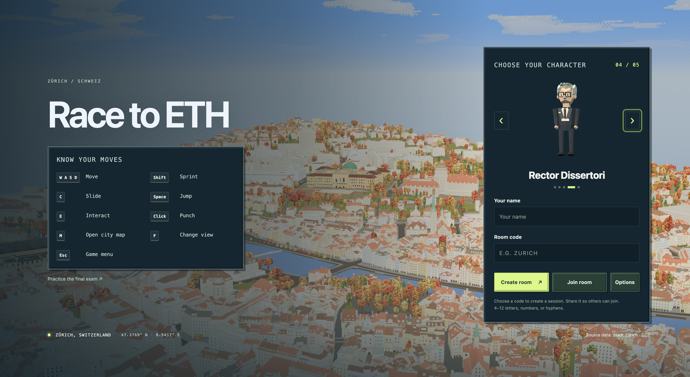
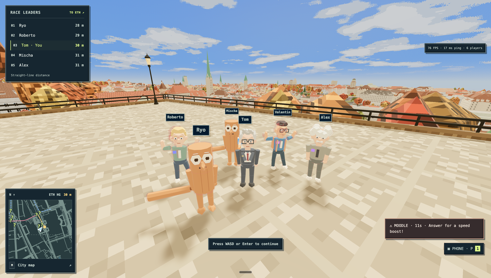
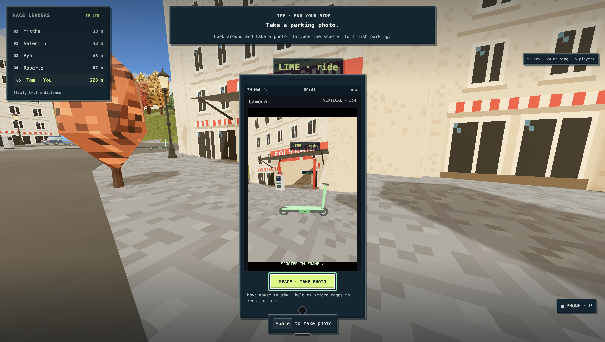
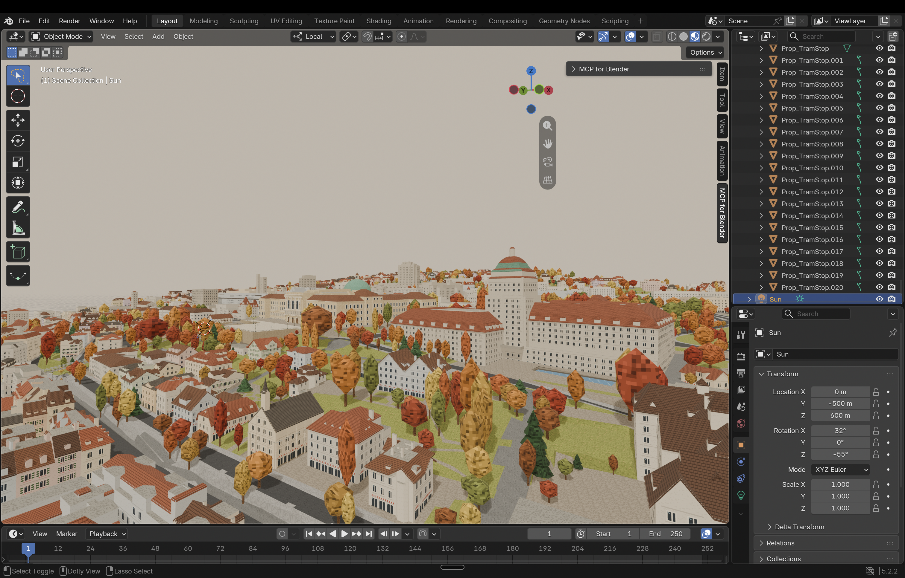

# Race to ETH

Race from Zürich Hauptbahnhof to ETH before your exam starts, through a playable 3D reconstruction of the city. Take a scooter, PubliBike, Polybahn or tram; navigate encounters and distractions; then tackle the final exam minigames. Every player races for themselves.



<table>
  <tr>
    <td width="50%"></td>
    <td width="50%"></td>
  </tr>
</table>

## Run locally

Requires **Node.js 22.12+** and npm. Run from the repository root:

```sh
npm ci
npm run dev
```

Open **http://localhost:5173**. Create a room, then join the same room code in another browser or tab. Choose characters; the host starts the round. Vite serves the client on **5173**, and Colyseus runs on **2567**.

The exported map and game assets are included. No Blender installation, GIS download, database or API keys are needed to play.

To run the production build locally:

```sh
npm run build
npm start
```

Open **http://localhost:2567**; one Node process serves the built client and multiplayer connections.

## Stack and layers

| Layer | Implementation |
| --- | --- |
| Client · `apps/client` | React, TypeScript and Vite for menus; Three.js for rendering. One render loop drives gameplay modules; shared pixel panels keep the UI consistent. |
| Server · `apps/server` | Node.js + Colyseus over WebSockets; Express serves the production client. Rapier handles entity contacts and loose-object physics. |
| Shared · `packages/shared` | Movement, collision queries, routes and network contracts shared by client and server. |
| Asset pipeline | Blender + Python for geometry and map repairs; meshopt-compressed glTF for delivery; TypeScript scripts generate shared world and transit data. |
| Deployment | Docker Compose runs the server behind Caddy, which serves static files, proxies WebSockets and provides HTTPS. |

## From city data to a playable world



The **1.6 × 1.9 km** map combines official city and cantonal datasets fetched through WFS:

| Source | What it contributes |
| --- | --- |
| [Zürich 3D buildings](https://data.stadt-zuerich.ch/dataset/geo_bauten___kombinierte_darstellung_heute) | Real building footprints, heights and LoD2 roof geometry. |
| [Zürich terrain TIN](https://data.stadt-zuerich.ch/dataset/geo_digitales_terrainmodell__tin_) | Elevation and the hillside between HB and ETH. |
| [Cantonal land cover](https://data.stadt-zuerich.ch/dataset/ktzh_av_mopublic__bodenbedeckung__ogd_) | Road, pavement, water and other surface polygons, draped onto the terrain. |
| [Cantonal individual trees, 2021/2022](https://data.stadt-zuerich.ch/dataset/ktzh_einzelbaeume_2021_2022__ogd_) | Tree positions and dimensions, rendered with reusable low-poly models. |

1. **Align the data.** Clip sources to the map bounds and convert Swiss LV95 / EPSG:2056 coordinates to local metres. Graphics, collision and vehicles share one origin. OpenStreetMap-derived streets supply the separate 2D map overlay.
2. **Make buildings recognizable.** Blender scripts retain real building geometry, fit windows and floors to façades, add shopfronts and roof thickness, and align roof-tile UVs. Custom HB and ETH models replace generic landmarks. Custom assets, such as lanterns and tram stations, add street-level detail and recognizable places to interact.
3. **Build the visual style.** Theme JSON defines procedural pixel textures and palettes for façades, roofs, roads, foliage and signs. Three.js materials add building colours, lighting and shadows; a GLSL shader handles colour grading. Themes change without geometry re-exports.
4. **Repair it for gameplay.** Scripted and hand-authored edits flatten bridges, fill ground holes, remove floating shelters and add walkable ramps. Custom geometry rebuilds Polybahn halls, its track corridor and Polyterrasse. Protected objects and removal collections preserve manual changes across rebuilds.
5. **Export graphics and movement separately.** Static geometry uses roughly 200 m tiles; trees and props use instancing. Blender exports a 2 m ground/obstacle grid with 0.5 m detail patches. `world:build` generates shared collision queries; `transit:build` generates routes. Checked-in exports keep normal builds independent of GIS services.

See the [map authoring guide](apps/client/assets-src/zurich/README.md) for rebuild order, tools and manual-edit safeguards. Source services, bounds and the recorded CC0 licence are in [map provenance](apps/client/public/maps/zurich/provenance.json). The 2D street overlay credits [OpenStreetMap contributors](https://www.openstreetmap.org/copyright).

## Multiplayer

Colyseus rooms manage the lobby, round and results; schema patches synchronize players and vehicles. Shared movement code runs locally for immediate response. Clients report positions for server validation; remote players interpolate on a delayed timeline to smooth network updates.

The server owns timing, membership, inventories, encounters and results, and referees collisions. Atomic seat claims prevent double occupancy. Disconnects release vehicles and transfer host duties.

## Development and deployment

| Command / view | Purpose |
| --- | --- |
| `npm run check` | Type-check the workspace. |
| `npm run lint` | Lint the client. |
| `npm test` | Run gameplay, networking and map regression tests. |
| `npm run world:build` / `npm run transit:build` | Regenerate shared data after map changes. |
| `http://localhost:5173/dev/ui` | Development-only offline playground: instant entry, no time limit, UI and encounter shortcuts. Uses the same game modules; no multiplayer server required. |

For public hosting, set `DOMAIN=game.example.com` in a root `.env`, point its DNS to the server and expose ports **80/443**, then run:

```sh
docker compose up -d --build
```

Caddy obtains the HTTPS certificate and routes matchmaking and WebSocket traffic to the private game server.

For server lag diagnostics, add `SERVER_PERF_LOG=1` to `.env`, recreate the server with
`docker compose up -d --build server`, and read `docker compose logs -f server` while a full room plays.
Every five seconds the server logs process CPU usage (100% means one CPU core), memory,
event-loop delay, and each room's simulation rate, tick duration, tick spacing and state-patch duration.
`tickOverBudget` counts ticks taking longer than the 50 ms simulation budget. Low `tickHz`
with short tick durations points to scheduling stalls or work elsewhere in the process;
long tick durations point to simulation work. Event-loop measurements include a 10 ms sampling interval.
These logs are disabled by default; set `SERVER_PERF_LOG=0` and recreate the server to stop them.
Use `docker stats` alongside the logs to check container CPU, memory and network usage, and check
the VM's CPU allocation/throttling and available network bandwidth. RAM and disk capacity alone
do not establish how much simulation work the VM can handle.

Run `npm run perf:server -- --players=20,40 --seconds=8` to compare isolated 20- and 40-player
rooms on a machine. This launches a separate test server and real headless clients using the
shared movement code, samples idle, crowded sprinting and spread-out sprinting, then cleans up.
It reports server-process CPU, memory, simulation/physics/patch timings, pre-compression payload
bandwidth and actual socket bandwidth after WebSocket framing/compression (excluding TCP/IP/TLS overhead).
`compressedClients` confirms compression negotiation and `bufferedBytes` shows queued sends.
It does not measure browser FPS, remote latency
or client rendering, and the load generator shares the test machine's CPU with the test server.
On the VM, use `docker compose run --rm --no-deps server node --import tsx scripts/server-load-test.ts --players=20,40 --seconds=8`
to run that benchmark in a separate container. Run it when the live game is quiet, since the
benchmark and live server share the VM's resources.

The server simulates and sends patches at 20 Hz; clients retain smooth frame-rate rendering
and interpolation. Positions and velocities use
explicit float32 wire encoding while authoritative server physics retains full precision;
animation uses one shared server clock instead of sending a clock for every player. Frequent
collision corrections use compact value arrays, with object corrections still accepted for
offline/debug encounters. WebSocket compression is enabled by default when negotiated by the
client: level 1, four concurrent jobs, and a reused per-connection dictionary to compress repeated
movement data. `SERVER_WS_CONTEXT_TAKEOVER=0` disables dictionary reuse and then applies a 512-byte
threshold so small messages stay uncompressed. Set `SERVER_WS_COMPRESSION=0` and recreate the server
to disable compression if the VM's diagnostic logs show CPU pressure. For a load-test comparison,
prefix the local benchmark with `SERVER_WS_COMPRESSION=0` or `SERVER_WS_COMPRESSION=1`.
Caddy also compresses static page/script/JSON responses with Zstandard or Gzip; this is separate
from game WebSocket compression and does not change already-compressed model/audio assets.
